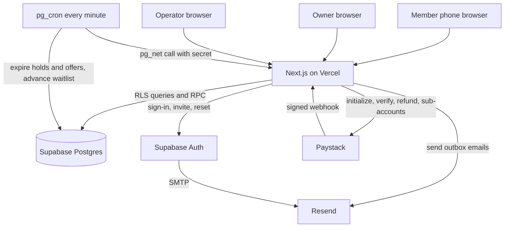
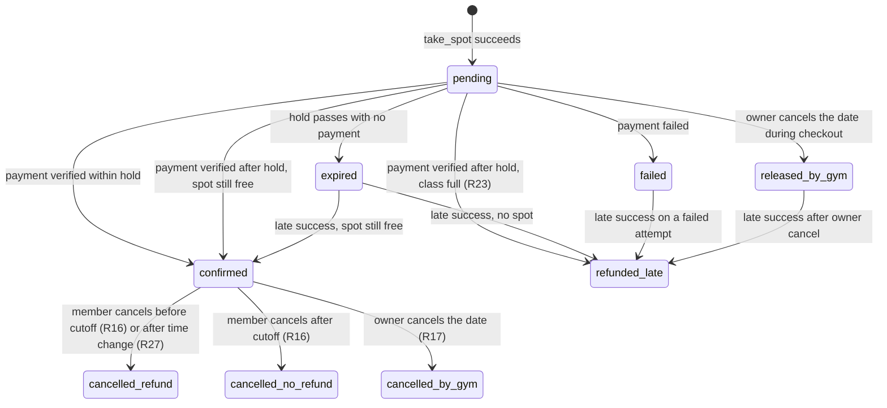
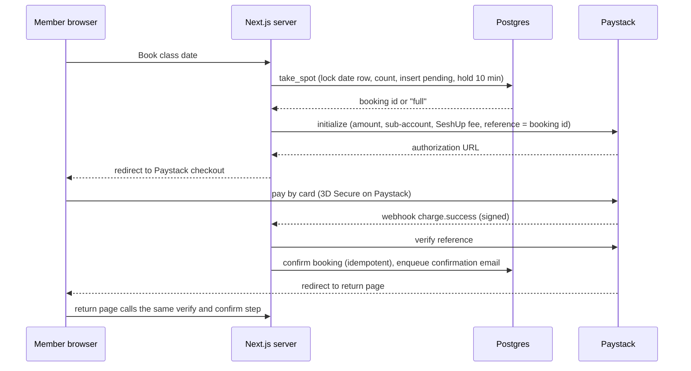
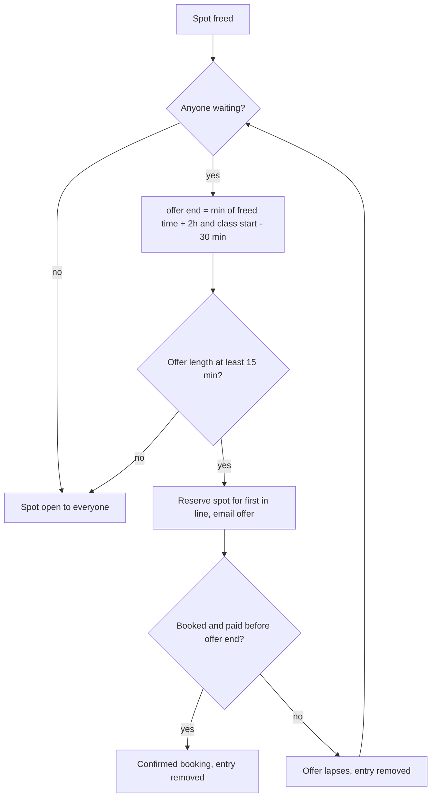
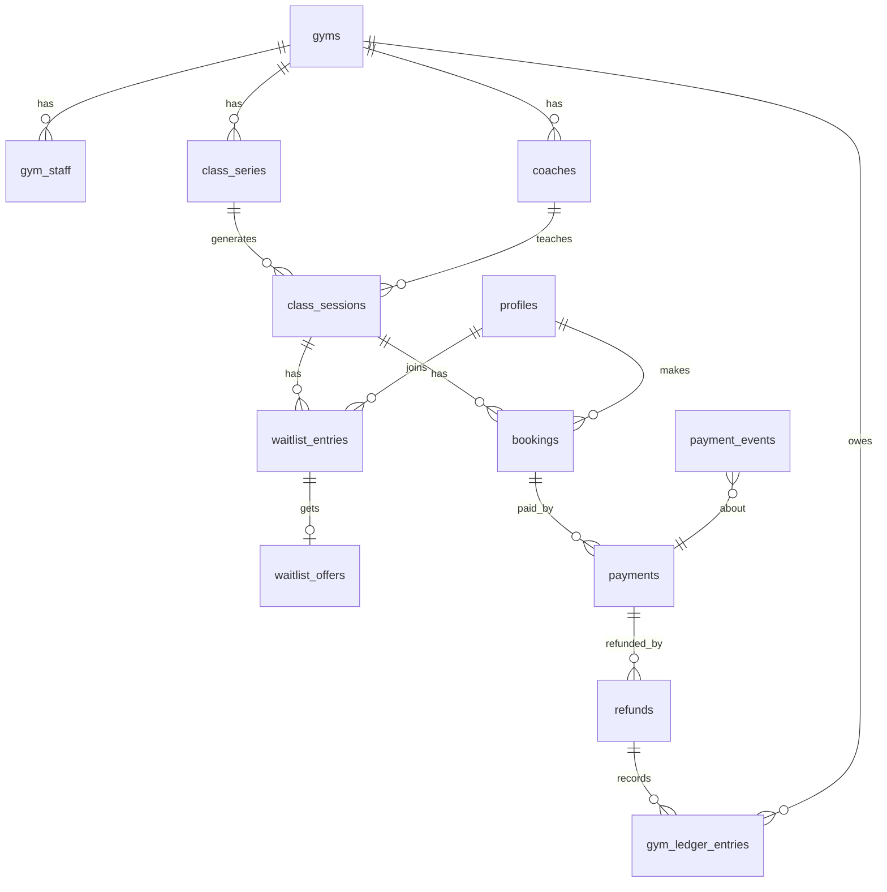

# SeshUp Boxing Gym Class Booking - Plan

## Goal Capsule

- **Objective:** Members of a boxing gym book and pay for group classes from their phone instead of through WhatsApp, and no class ever goes over its spot limit. This plan covers the first release only: group classes on a mobile web link, run for one pilot gym on a system that can host many gyms.
- **Means:** A Next.js web app on Vercel backed by Supabase (KTD1), with card payments split to each gym through Paystack sub-accounts (KTD7).
- **Product authority:** This Product Contract governs the first release. 1-to-1 sessions, open gym slots, and the iPhone and Android apps are later releases and are not active scope here. On product behavior the R-IDs win. On mechanism the KTDs win. Units override neither.
- **Open blockers:** The user supplies Paystack test keys before U5, which cannot run its test-mode check without them. Go-live gates are listed under Outstanding Questions.
- **Stop conditions:** Stop and ask the user if the U5 test-mode check shows that Paystack cannot return 100% of a split payment to the member, or cannot onboard a South African gym sub-account that settles in rand. Either result invalidates KTD7 and needs a re-plan of U5, U6, U9, and U10 (PayFast is the researched fallback).
- **Execution profile:** One pull request. Built by `ce-work` unit by unit in U-ID dependency order. The project states no rule that would justify a split.
- **Who finishes:** `ce-work` implements and verifies against Paystack test mode. The user supplies Paystack test keys before U5, and handles live keys, the pilot gym's sub-account, and the Vercel and Supabase production projects at go-live.

---

## Product Contract

Product Contract preservation: changed: added R22 to R31 and AE7 to AE9 from the planning-time scoping confirmation (checkout hold, late payments, booking window, waitlist timing, owner edits, accounts, refund settlement). The three questions deferred to planning are resolved (KTD7, KTD12, R30) and removed from Outstanding Questions. Existing R1 to R21 and AE1 to AE6 are unchanged.

### Summary

SeshUp is a booking system for boxing gyms that you sell to many gyms. The first release is a phone-friendly web link where members create an account, see the gym's weekly class timetable, and book and pay for a class by card. Full classes offer a waitlist, cancellations are refunded before an owner-set cutoff, and each owner sets up classes in their own admin area. Payments go to the gym's own account, and SeshUp takes a percentage of each booking.

The plan builds this as one Next.js and Supabase app. Paystack splits each card payment between the gym's sub-account and SeshUp. Postgres enforces the spot limit, and SeshUp keeps a ledger of what each gym owes back from refunds.

### Problem Frame

The pilot gym, run by someone you know, takes class bookings through WhatsApp messages. Nothing enforces a spot limit, so classes overfill. The owner spends time reading and answering messages to manage who is coming.

Other boxing gyms have the same problem. General gym software such as Mindbody, Glofox, and TeamUp exists, but these tools are built for every kind of gym and are more complex and more expensive than a small boxing gym needs. SeshUp's position is simpler and cheaper, built around boxing gyms.

<!-- ce-section: work-relationships -->
### How This Work Fits Together

This plan covers the first release: group class booking with card payment on a mobile web link. The breakdown below is the current understanding, not a committed roadmap.

- 1-to-1 sessions with a coach. Depends on this release. Shares the idea of a time slot with a spot limit (one spot) and the same payment and cancellation rules. Brings coach logins so coaches set their own availability.
- Open gym slots. Depends on this release. Shares the same slot, payment, and cancellation rules.
- iPhone and Android apps. Depends on this release. Members use the same accounts and bookings as the web link.
- Class register for attendance and no-shows. Depends on this release. Still to decide when it is built. Likely an early add-on.

### Actors

- A1. Platform operator: you. Creates each gym, sets its fee percentage, and onboards its owner.
- A2. Gym owner: sets up the gym's classes, schedule, coaches, prices, and cancellation cutoffs, and sees who is booked.
- A3. Member: a person who trains at the gym. Books, pays for, and cancels classes.
- A4. Coach: shown on the classes they teach. Has no login in this release.

### Key Decisions

- **Group classes ship first, on a mobile web link.** The pilot gym gets a working system in about 4 to 6 weeks instead of waiting for all booking types and store apps. (session-settled: user-directed, chosen over launching classes, 1-to-1s, open gym, and store apps together: the smallest version that stops WhatsApp bookings and overcrowding.)
- **Members pay per booking by card.** Governs R13, R16, R17. (session-settled: user-directed, chosen over no payments and over memberships or class packs: it was the user's choice.)
- **Members sign in with an account (name, email, password).** Governs R12, R28, R30. (session-settled: user-directed, chosen over phone-number quick-book with text codes: the user preferred familiar accounts.)
- **Refund before an owner-set cutoff, no refund after.** Governs R8, R16. (session-settled: user-approved, chosen over always refund, never refund, and credit instead: discourages last-minute cancellations while staying fair.)
- **Full classes get a notify-then-book waitlist.** Members are never booked or charged without acting. Governs R19, R20, R25. (session-settled: user-approved, chosen over auto-booking from the waitlist and over no waitlist.)
- **You set up each gym yourself.** Gym self-signup comes later. Governs R1, R29. (session-settled: user-approved, chosen over gym self-signup and over a separate installed copy per gym: less to build and you learn from each early customer.)
- **Money goes to the gym's own payment account, and SeshUp takes a percentage of each booking.** Gyms pay nothing upfront. Governs R3, R4. (session-settled: user-directed, chosen over a flat monthly fee and over collecting all payments then paying gyms out.)
- **A full refund returns SeshUp's fee too.** The member gets back everything they paid. Governs R16, R17.
- **The gym absorbs card processing fees kept on a refund.** The gym took the booking, and SeshUp's income stays predictable. Governs R16, R31. (session-settled: user-approved, chosen over SeshUp absorbing it and over deducting it from the member's refund.)
- **SeshUp absorbs the processing fee on refunds the system causes.** A late payment for a spot that is gone is SeshUp's fault, not the gym's. Governs R23. (session-settled: user-approved, chosen over charging the gym for every refund.)
- **Refund amounts owed by a gym are settled monthly from a statement.** Nothing is deducted from gym payouts automatically in this release. Governs R31. (session-settled: user-approved, chosen over automatic netting against payouts: the provider may not support it and the pilot volume is small.)
- **The first market is South Africa, with prices in rand (ZAR).** The pilot gym is there. Governs R3, R5.
- **Email is the only notification channel in this release.** Members sign up with email, so no text message cost is needed yet. Governs R21.

### Requirements

**Gyms and the platform**

- R1. The platform operator creates each gym, sets its name, and sets its SeshUp fee percentage.
- R2. Each gym's classes, members, bookings, and payments are kept fully separate from every other gym.
- R3. A gym connects its own card payment account before members can book its classes, and member payments go directly to that account.
- R4. SeshUp's fee percentage for the gym is taken automatically from each booking payment.
- R31. SeshUp records what each gym owes back from refunds, which is any gym share SeshUp paid out on the gym's behalf plus any processing fee the gym bears, and the operator sees a monthly statement per gym to settle.

**Accounts**

- R28. One member account works at every gym. Each gym's owner sees only the members and bookings of their own gym.
- R29. The operator invites each gym's owner by email, and the owner sets their own password from that invite.
- R30. Members and owners reset a forgotten password through an emailed link.

**Owner admin area**

- R5. The owner creates a class with a name, description, start time, length, spot limit, and price.
- R6. The owner sets a class to repeat weekly on chosen days, and can change or cancel a single date without affecting the other dates.
- R7. The owner adds coaches by name and assigns one coach to each class.
- R8. The owner sets the cancellation cutoff for each class, with a default of 12 hours before the start.
- R9. The owner marks each class with a level label: Beginner, Intermediate, Advanced, or Sparring. The label is shown to members and does not restrict who can book.
- R10. The owner sees, for each class date, who is booked, how many spots are left, and who is on the waitlist.
- R26. The owner cannot set a class date's spot limit below the number of spots already taken on it, and a price change applies only to bookings made after the change.
- R27. When the owner moves the time of a class date that has bookings, every booked member is emailed and can cancel with a full refund, whatever the cutoff, until the class starts.

**Member booking**

- R11. Anyone with the gym's link sees its weekly timetable on a phone, with each class's time, coach, level, price, and spots left, without signing in.
- R12. A member creates an account with name, email, and password before their first booking, and signs in for later bookings.
- R13. A member books one spot for themselves in a class and pays by card at the time of booking. The spot is confirmed only when the payment succeeds.
- R14. A class never has more confirmed bookings than its spot limit, including when several members try to book the last spot at the same moment.
- R15. A member sees their upcoming bookings and can cancel any of them.
- R22. Starting checkout holds the spot for that member for 10 minutes, and a held spot counts as taken. If the payment does not succeed within the hold, the spot is released.
- R23. If a payment succeeds after its hold ran out and the class is now full, the member gets an automatic full refund and an email saying the spot is gone.
- R24. A class date is bookable from 2 weeks before it until it starts, and a member holds at most one booking per class date.

**Cancellations and refunds**

- R16. When a member cancels before the class's cutoff, they get a full refund of everything they paid, including SeshUp's fee. Any processing fee the card provider keeps is charged to the gym. When they cancel after the cutoff, the booking is cancelled and the spot is freed, with no refund.
- R17. When the owner cancels a class date, every member booked on it gets a full refund, whatever the cutoff.

**Waitlist**

- R18. When a class is full, a member can join its waitlist. Waitlist places are in the order members joined.
- R19. When a spot opens, the first member on the waitlist is emailed an offer and the spot is held for them for a set time. If they do not book and pay in that time, the offer passes to the next member.
- R20. A member on the waitlist is never booked or charged unless they book and pay themselves.
- R25. A waitlist offer holds the spot for 2 hours, cut short so it ends 30 minutes before the class starts. While an offer is live, the spot is kept for that member. When a spot opens too late for an offer of at least 15 minutes, the spot opens to everyone instead.

**Notifications**

- R21. Members get an email for each booking confirmation, cancellation, refund, owner-cancelled class, owner time change, late-payment refund, and waitlist offer.

### Key Flows

- F1. Member books a class for the first time
  - **Trigger:** A member taps the gym's link in the gym's WhatsApp group.
  - **Actors:** A3
  - **Steps:** Sees the week's timetable. Picks a class with spots left. Creates an account. Pays by card. Gets a confirmation email.
  - **Outcome:** The member has a confirmed spot and the class's spots-left count drops by one.
  - **Covered by:** R11, R12, R13, R14, R21, R22, R24

- F2. Member cancels a booking
  - **Trigger:** A member can no longer attend.
  - **Actors:** A3
  - **Steps:** Opens their upcoming bookings. Cancels the class. Gets a refund or not, per R16. Gets an email.
  - **Outcome:** The spot is freed and the waitlist offer starts, per R19.
  - **Covered by:** R15, R16, R19, R21

- F3. Waitlisted member gets a spot
  - **Trigger:** A spot opens in a full class.
  - **Actors:** A3
  - **Steps:** The first member on the waitlist gets an offer email. They book and pay within the hold time, or the offer passes on.
  - **Outcome:** The spot is filled by someone who chose to book, and nobody is charged without acting.
  - **Covered by:** R18, R19, R20, R21, R25

- F4. Owner sets up the timetable
  - **Trigger:** A new gym goes live, or the owner adds a class.
  - **Actors:** A2
  - **Steps:** Adds coaches. Creates each class with its details, level, cutoff, and weekly repeat. Shares the gym's link in WhatsApp.
  - **Outcome:** Members see and book the timetable.
  - **Covered by:** R5, R6, R7, R8, R9, R26

- F5. Operator onboards a new gym
  - **Trigger:** A gym agrees to use SeshUp.
  - **Actors:** A1, A2
  - **Steps:** The operator creates the gym, sets its fee percentage, and invites the owner. The owner sets a password. The operator connects the gym's payment account. The owner sets up the timetable, per F4.
  - **Outcome:** The gym can take paid bookings.
  - **Covered by:** R1, R3, R4, R29

### Acceptance Examples

- AE1. **Covers R14.** Given a class with 12 spots and 11 confirmed bookings, when two members try to book at the same moment, then exactly one gets the spot and the other is offered the waitlist.
- AE2. **Covers R16.** Given a 12-hour cutoff on a Monday 6pm class, when a member cancels at 5am Monday, then they get a full refund. When they cancel at 7am Monday, then their spot is freed and they get no refund.
- AE3. **Covers R17.** Given the owner cancels Wednesday's class 2 hours before it starts, when the class had 10 booked members, then all 10 get a full refund and an email.
- AE4. **Covers R19, R20.** Given a full class with 3 members on the waitlist, when a booked member cancels, then only the first waitlisted member gets an offer. If they do nothing during the hold time, the second member gets the offer and the first is not charged.
- AE5. **Covers R6.** Given a class repeating every Monday and Wednesday, when the owner cancels one Wednesday, then only that date is cancelled and all other dates stay bookable.
- AE6. **Covers R4, R16.** Given a SeshUp fee of 5% on a booking, when the member cancels before the cutoff, then the member gets back the full amount they paid, including SeshUp's 5%.
- AE7. **Covers R22, R23.** Given a class with 1 spot left, when member A starts checkout and does not pay within 10 minutes, then member B can take the spot. If A's payment then succeeds after B has booked, A gets a full refund and an email.
- AE8. **Covers R25.** Given a 6pm class, when a spot opens at 3pm, then the first waitlisted member's offer runs until 5pm. When a spot opens at 5pm, then the offer runs until 5:30pm. When a spot opens at 5:20pm, then an offer would last only 10 minutes, so the spot opens to everyone.
- AE9. **Covers R26.** Given a class date with 9 spots taken, when the owner tries to lower its spot limit to 8, then the change is refused with a message.

### Success Criteria

- Within 2 months of launch at the pilot gym, no class bookings happen through WhatsApp.
- Within the same period, no class has more people booked than its spot limit.

### Scope Boundaries

**Deferred for later**

- 1-to-1 sessions with coaches, and coach logins.
- Open gym slots.
- iPhone and Android apps.
- A class register for attendance and no-show tracking.
- Restricting who can book a level, such as Sparring.
- A sparring safety waiver and health questions.
- Parents booking for children, and booking for a friend.
- Text message or WhatsApp notifications.
- Gyms signing up and onboarding themselves.
- Memberships, class packs, and credits.

**Outside this product's identity**

- A general-purpose gym management system with marketing, CRM, payroll, and retail features. SeshUp stays simple booking for boxing gyms.
- A WhatsApp chatbot. SeshUp replaces booking by message, it does not automate it.

**Considered and not built in this release**

- Automatic netting of refund amounts against gym payouts. R31 uses a monthly statement instead. Revisit when refund volume makes manual settlement a burden.
- Email address verification before booking. A typo loses notifications but not the booking. Revisit if bounced emails show up in the outbox logs.
- Class reminder emails and owner emails for each new booking or cancellation. Not asked for. The owner sees live numbers in R10.
- Free (R0) classes. Prices must be above zero, so every booking goes through checkout. Revisit if a gym asks for free trial classes.
- Rate limiting on sign-up and checkout. Supabase Auth applies its own limits and pilot traffic is small. Revisit if abuse appears.
- A limit on repeated checkout holds by one member. Holding spots in 10-minute cycles is unlikely at pilot scale. Revisit if members report classes that show full but never fill.
- Archiving or deleting coaches. R7 asks only for adding and assigning. Revisit when a gym's coach list goes stale.

#### Deferred to Follow-Up Work

- Moving the pilot gym onto live Paystack keys, including the gym's sub-account KYC. This waits on the gym's documents, not on code.

### Dependencies / Assumptions

- The pilot gym's owner is willing to share the link in their WhatsApp group and ask members to book only through it.
- Members have a card they can pay with online.
- Paystack supports South African gym sub-accounts that settle in rand, with a SeshUp fee per payment. Research supports this but could not read Paystack's official docs from the planning sandbox. U5 verifies it in test mode before payment-dependent units are built.
- The waitlist hold rule is R25. The owner cannot change it in this release.
- SeshUp's position as simpler and cheaper than general gym software is assumed to hold. How it fares if those tools add a cheap simple plan was not tested.

### Outstanding Questions

**Gates before go-live (not blocking the build)**

- Who bears Paystack's fee on an ordinary booking payment. KTD7 assumes the gym does, as with any merchant account. Confirm with the pilot gym before go-live.
- Whether SeshUp's fee needs VAT shown or charged. This is an accounting question for the user, and it may change receipt wording only.
- Which Supabase region hosts member data, given South Africa's POPIA rules. The user should confirm this before creating the production project.

---

## Planning Contract

### Key Technical Decisions

- KTD1. **Next.js (App Router, TypeScript) on Vercel with Supabase for Postgres, Auth, and row-level security.** One codebase serves the member pages, the owner admin, the operator area, the Paystack webhook, and the job endpoint. Supabase Auth covers email and password sign-in, invites (R29), and reset links (R30) without custom auth code. (session-settled: user-directed, chosen over Next.js with a separate Postgres host and auth library, and over Rails with Postgres: least to build and host, and the user already has Supabase and Vercel connected.)
- KTD2. **Tenancy is a `gym_id` column on every gym-owned table, enforced by row-level security.** Owners are linked to gyms through a `gym_staff` table, and policies allow access only to rows of gyms where the caller is staff. The operator is a row in `platform_admins`. Member identity is global (`profiles` keyed by the auth user), while bookings, waitlist entries, and payments carry `gym_id` (R2, R28). Anonymous timetable reads go through one `security definer` function that returns only public fields and accepts at most a 3-week range (R11).
  - Staff may write only `coaches`, `class_series`, and `class_sessions`, with `WITH CHECK` so `gym_id` cannot change. On `class_sessions`, column grants exclude the cancelled flag, start time, length, spot limit, and time-changed marker, which change only through the owner-facing functions. Money tables (`payments`, `refunds`, `gym_ledger_entries`), booking status, and gym fee and sub-account columns are written only by service-role code or the functions below. Members have no direct insert or update on `bookings`.
  - Members read their own profile. Staff read a profile only when that member has a booking or waitlist entry at their gym, so emails never leak across gyms.
  - Database functions follow one boundary rule. Member-facing functions (`take_spot`, member cancel, waitlist join and leave) take no member id and derive the caller from `auth.uid()`. Owner-facing functions (cancel date, time change, R26 limit edit) take only a session id, derive the caller from `auth.uid()`, and check `gym_staff` against the locked session row's own `gym_id`. Every other function (confirm, refund, ledger, tidy, `offer_next`) is executable by `service_role` only, with execute revoked from `public`, `anon`, and `authenticated`. Every `security definer` function pins `search_path`.
  - Role checks never read `user_metadata`, which users can edit.
- KTD3. **The spot limit is enforced inside Postgres, not in app code.** A `take_spot` database function locks the class date row with `select ... for update`, counts the spots taken, and inserts the booking in the same transaction. A spot counts as taken when its booking is confirmed, or pending with an unexpired hold, or reserved by a live waitlist offer. A partial unique index on (class date, member) for active bookings enforces R24's one-booking rule. This is the only way R14 and AE1 hold under concurrent requests from many Vercel function instances.
  - One SQL function, `spots_taken(session)`, owns the count. `take_spot`, confirm, the R26 limit edit, `offer_next`, and `public_timetable` all call it.
  - Every path that takes or frees a spot locks the `class_sessions` row first, then bookings and offers. A path touching several sessions locks them in id order, which prevents deadlocks.
  - `offer_next` runs in the same transaction as whatever freed the spot. `take_spot` also calls it under the lock before counting, so a hold that expired by time goes to the waitlist before anyone else (R19).
  - A live offer counts as one taken spot unless its holder has a pending or confirmed booking on that session, in which case only the booking counts. The offer stays live until its offer end, so a holder whose checkout lapses can try again. `offer_next` skips entries that already have an offer.
- KTD4. **Holds expire by time, not by a job.** Every "spots taken" count compares `hold_expires_at` with `now()`, so a missed or late job can never block or overfill a class (R22). A pending hold counts as taken until 3 minutes after `hold_expires_at`, a grace window for webhook and redirect delay. The member sees a 10-minute timer, and confirm treats a success inside the grace as within the hold. The scheduled job only tidies state and sends follow-up emails. The same rule applies to waitlist offers (R25).
- KTD5. **Classes are stored as a series plus one row per date.** `class_series` holds the template and weekdays (R6). `class_sessions` holds one row per date with its own time, spot limit, price, cutoff, coach, and a cancelled flag, so single-date changes are plain row edits (R6, AE5). Sessions are generated for a rolling window of 2 weeks plus a margin (R24). Editing a series updates future sessions that have no bookings and no single-date edits. Sessions with bookings change only through single-date edits, which carry R26 and R27. A series edit locks each session and re-checks for bookings before changing it. A unique index on (series, local date) makes generation an upsert, so running it twice never doubles a date.
- KTD6. **Money is integer cents in ZAR, and time is UTC with a gym time zone.** Each gym has an IANA time zone (`Africa/Johannesburg` for the pilot). Cutoffs, holds, and the booking window are compared as absolute instants. The SeshUp fee for a booking is computed once at checkout, rounded half-up to the cent, and stored on the payment row, so later fee or price changes never alter it (R4, R26).
- KTD7. **Paystack with one sub-account per gym.** The server initializes each transaction with the gym's sub-account code, a flat `transaction_charge` equal to SeshUp's fee in cents, and the processing fee borne by the sub-account. Stripe Connect does not support platforms registered in South Africa, and Yoco, Peach, and Ozow showed no usable split support. PayFast's split exists but is custom-integration only (see Alternative Approaches). All Paystack calls sit behind a `PaymentProvider` interface with a fake for tests, so a fallback provider would replace one module.
- KTD8. **A payment is confirmed only by the server, never by the browser redirect.** The webhook route verifies the `x-paystack-signature` HMAC-SHA512 over the raw body, records the event in `payment_events` with a unique event key so retries are no-ops, then re-checks the transaction through Paystack's verify endpoint before acting. The checkout return page also calls verify, so a slow webhook does not leave the member waiting. Both paths call the same idempotent confirm step.
  - Confirm acts only when status is success, currency is ZAR, and the reference, amount, sub-account, and transaction charge all match the stored `payments` row. Price and fee come from the session row `take_spot` locked, never from the request.
  - Confirm handles a success from any non-confirmed booking state (pending, expired, failed, released by the gym). It confirms only when the session is live, a spot is free, and the member has no other active booking on that date. Otherwise the booking becomes `refunded_late` with its processing fee attributed to SeshUp, or to the gym when the gym cancelled the date (R23).
  - The return page shows status only to the member who owns the booking.
- KTD9. **A refund ledger records who owes what.** Research reports that Paystack keeps its fee on refunds and may fund split refunds from SeshUp's main balance rather than the sub-account. Each refund writes `gym_ledger_entries` rows: the gym share SeshUp funded, always owed by the gym (R31), and the processing fee kept, owed by the gym for R16, R17, and R27 and absorbed by SeshUp for R23. Ledger rows are written only in the transaction that moves a refund to `processed`, guarded so a refund already processed writes nothing, with a unique index on (refund, entry kind). A refund that fails after Paystack accepted it writes no ledger rows. The U5 test-mode check fixes which rows apply, and the operator statement sums them per month (R31).
- KTD10. **Background work runs from Supabase `pg_cron`, calling one Next.js job endpoint.** A one-minute `pg_cron` schedule runs a SQL function that expires holds and offers, advances waitlists, and generates sessions. It then calls the `/api/jobs/run` route through `pg_net` with a shared secret read from Supabase Vault, never written in a migration. The route compares it in constant time, then sends outbox emails and processes pending refunds. This avoids depending on Vercel's cron frequency per plan, and correctness does not depend on it (KTD4).
- KTD11. **Email goes through an outbox table and Resend.** Domain events insert rows into `email_outbox` in the same transaction as the state change, and the job route sends them with retry and a sent marker. Supabase Auth's invite and reset emails use Resend over SMTP so all mail comes from one sending domain (R21, R29, R30).
- KTD12. **Each gym's link is a path: `/g/<gym-slug>`.** It is one domain and one certificate, and the slug is set by the operator (R1). Owner pages live under `/admin/<gym-slug>` and operator pages under `/operator`.
- KTD13. **Refunds run as background work with a status.** Cancelling writes the booking change and a `refunds` row with status `pending` in one transaction, and the job route calls Paystack. A failed call retries with backoff and shows on the operator area after repeated failures. This keeps an owner cancelling a 10-person class (AE3) fast and safe to retry.
  - Refunds move through `pending`, `submitting`, `submitted`, then `processed` or `failed`, with a unique index on the payment so a payment has at most one refund.
  - The job claims rows with `FOR UPDATE SKIP LOCKED`. Before retrying a row left in `submitting`, it asks Paystack for existing refunds on that transaction, and an "already refunded" reply counts as success.
  - Status changes are conditional on the current state, so when an owner and a member cancel at once, the second change does nothing instead of failing.

- KTD14. **Money history is never deleted, and personal data is kept minimal.** Foreign keys from bookings, payments, refunds, and ledger rows to sessions, profiles, and gyms use `ON DELETE RESTRICT`. Sessions and series are cancelled or ended, never deleted. Erasing a member anonymises their profile. `payment_events` stores only the fields SeshUp needs, and raw webhook payloads and sent outbox bodies are purged after 90 days.

### High-Level Technical Design

Components and their main calls:



Booking states (KTD3, KTD4, KTD8, KTD13):



Refund rows have their own status (KTD13), so a booking's state never waits on Paystack.

Checkout sequence (R13, R22, KTD8):



Waitlist offer timing (R19, R25):



Core data model (KTD2, KTD5, KTD9):



### Output Structure

```text
app/
  g/[gymSlug]/                 public timetable, class page, checkout return
  account/                     member bookings and cancel
  auth/                        sign-up, sign-in, reset, set password
  admin/[gymSlug]/             owner admin area
  operator/                    operator area
  api/webhooks/paystack/       Paystack webhook
  api/jobs/run/                job endpoint called by pg_cron
lib/
  supabase/                    server, browser, and service-role clients
  payments/                    PaymentProvider interface, Paystack, fake
  booking/ refunds/ waitlist/  domain services
  email/                       outbox, sender, templates
  time/ money/                 gym time zone and fee helpers
supabase/
  migrations/                  schema, RLS, functions, cron
  seed.sql                     local demo gym
tests/
  unit/ db/ e2e/
```

### Alternative Approaches Considered

- **Stripe Connect.** Best-documented marketplace API, but Connect platforms must be registered in a supported country, and South Africa is not one. Paystack is Stripe's route for South Africa.
- **PayFast split payments.** Available in South Africa and the fallback if U5 fails. It needs a custom integration, and its split payments reportedly refund in full only. That still fits this release, since every refund here is full.
- **Spot limit checked in app code with a retry.** Simpler to write, but two Vercel instances can both read "1 spot left" and both insert. Rejected for KTD3.
- **No checkout hold, refund the loser.** Avoids hold expiry logic, but every race on a last spot charges and refunds a member and costs a kept fee. Rejected in favor of R22.
- **A queue service such as Inngest for jobs.** Better retries and visibility, but one more vendor and account. `pg_cron` is already in Supabase (KTD10).

### System-Wide Impact

- **Money:** Every amount is integer cents (KTD6). The ledger (KTD9) is the only place gym debts are tracked, so it must be written in the same transaction as each refund row.
- **Auth boundary:** Three roles share one Supabase project: member, owner (via `gym_staff`), and operator (via `platform_admins`). The service-role key lives in `lib/supabase/admin.ts`, marked server-only, and is used only in the webhook route, the job route, the checkout return page's confirm step, and operator actions. Every operator action re-checks `platform_admins` with `auth.getUser()` before using it. Middleware guards are for user experience only. RLS and the KTD2 function rule are the boundary.
- **Personal data:** Names and emails of members are stored per KTD2. Card data never touches SeshUp, because Paystack hosts the card form. Gym bank details entered in U6 pass straight to Paystack and are never stored, logged, or sent to error tracking. Retention follows KTD14.
- **Operations:** The operator area shows failed refunds, unsent emails, and gyms without a connected sub-account, so failures are visible without reading logs.

### Risks & Dependencies

| Risk | Mitigation |
|---|---|
| Paystack split-refund behavior differs from research (who is debited, whether the full amount returns) | U5 runs a test-mode payment and refund before payment-dependent units, and the result sets which ledger rows KTD9 writes. Stop condition in the Goal Capsule. |
| SeshUp's Paystack balance cannot cover a refund that is funded from the main account | Refund rows stay `pending` and retry (KTD13), and the operator area flags them. Keep a float in the main balance at go-live. |
| Late webhook or lost redirect leaves a paid member unconfirmed | Verify on both webhook and return page (KTD8). A 3-minute grace window after each hold (KTD4) covers delivery delay. |
| Vercel's Hobby plan is for non-commercial use | Use a paid Vercel plan for production. Check the current terms at go-live. |
| Member data region under POPIA | Gate listed under Outstanding Questions. Region is chosen when creating the production Supabase project. |
| Paystack webhook signature header change (a newer signing header was announced) | Verification sits in one function in `lib/payments/paystack.ts`. U5 confirms which header test mode sends. |

### Sequencing

U1 to U4 lay the base: project, schema, accounts, and email. U5 is the gate for money: it builds the payment adapter and runs the test-mode check. U6 to U8 give the operator, owner, and public timetable. U9 to U11 build booking, refunds, and the waitlist on top. The Unit Index lists exact dependencies.

---

## Implementation Units

| U-ID | Title | Key files | Depends on |
|---|---|---|---|
| U1 | Project scaffold and tooling | `package.json`, `supabase/config.toml`, `.github/workflows/ci.yml` | none |
| U2 | Database schema, tenancy, and row-level security | `supabase/migrations/` | U1 |
| U3 | Accounts, sign-in, invites, and password reset | `app/auth/`, `lib/supabase/` | U2 |
| U4 | Email outbox, sender, and job endpoint | `lib/email/`, `app/api/jobs/run/` | U2 |
| U5 | Payment provider adapter and Paystack test-mode check | `lib/payments/` | U1 |
| U6 | Operator area | `app/operator/` | U3, U4, U5 |
| U7 | Owner admin: coaches, classes, and schedule | `app/admin/[gymSlug]/`, `lib/booking/schedule.ts` | U3, U4 |
| U8 | Public timetable | `app/g/[gymSlug]/` | U7 |
| U9 | Booking and checkout | `lib/booking/`, `app/api/webhooks/paystack/` | U4, U5, U8 |
| U10 | Cancellations, refunds, and the ledger | `lib/refunds/`, `app/account/` | U9 |
| U11 | Waitlist | `lib/waitlist/` | U10 |

### U1. Project scaffold and tooling

- **Goal:** A running Next.js app connected to a local Supabase stack, with lint, type checks, and the three test layers wired into CI.
- **Requirements:** Supports all. KTD1.
- **Dependencies:** none
- **Files:** `package.json`, `tsconfig.json`, `next.config.ts`, `app/layout.tsx`, `app/page.tsx`, `supabase/config.toml`, `supabase/seed.sql`, `vitest.config.ts`, `playwright.config.ts`, `.env.example`, `.github/workflows/ci.yml`, `README.md`
- **Approach:**
  1. Create the Next.js App Router project in TypeScript with a mobile-first base layout.
  2. Initialize Supabase locally (`supabase/config.toml`) and add `@supabase/ssr` and `@supabase/supabase-js`.
  3. Add npm scripts for `lint`, `typecheck`, `test` (Vitest unit), `test:db` (Vitest against the local Supabase database), and `test:e2e` (Playwright, phone viewport).
  4. List every environment variable in `.env.example` with no real values: Supabase URL and keys, Paystack secret key, Resend key, job secret.
  5. CI runs lint, typecheck, unit tests, database tests, and end-to-end tests against `supabase start`.
- **Execution note:** This is mostly setup. Prove it with a smoke check that the app boots and one trivial test passes in each layer.
- **Test expectation:** none -- scaffolding only. The smoke tests prove the wiring.
- **Verification:** The home page renders locally, each test script runs and passes, and CI is green on the branch.

### U2. Database schema, tenancy, and row-level security

- **Goal:** All tables, constraints, functions, and policies the release needs, with each gym's data visible only to its own staff and its own members.
- **Requirements:** R2, R28, R5 to R10 (storage), R22, R24, R26. KTD2, KTD3, KTD4, KTD5, KTD6.
- **Dependencies:** U1
- **Files:** `supabase/migrations/<timestamp>_core_schema.sql`, `supabase/migrations/<timestamp>_rls_policies.sql`, `supabase/migrations/<timestamp>_booking_functions.sql`, `supabase/seed.sql`, `lib/supabase/types.ts` (generated), `tests/db/tenancy.test.ts`, `tests/db/take-spot.test.ts`
- **Approach:**
  1. Tables from the data model in High-Level Technical Design, plus `platform_admins`, `email_outbox`, and `payment_events`. Every gym-owned table carries `gym_id`.
  2. Gyms carry name, slug, fee percentage (basis points), IANA time zone, and Paystack sub-account code (nullable until connected).
  3. `class_sessions` carries its own start, length, spot limit, price, cutoff hours, coach, level, and cancelled flag (KTD5).
  4. `take_spot(session_id)` implements KTD3 with the counting rule from KTD3 and KTD4. It rejects cancelled sessions, sessions outside R24's window, gyms with no sub-account (R3), and members who already hold an active booking.
  5. `public_timetable(gym_slug, from, to)` is the only anonymous read (KTD2). It returns time, coach name, level, price, and spots left, with no member data.
  6. RLS: members read their own bookings and waitlist entries. Staff read and write their gym's rows. Operators read all. No anonymous table access.
  7. The R26 limit check runs in a function that locks the session and calls `spots_taken`.
  8. Grants, policies, and foreign keys follow KTD2 and KTD14. Gym-owned text is escaped wherever it is rendered.
- **Execution note:** Write the concurrency and tenancy tests first, against the real local database. Mocks cannot prove row locks or RLS.
- **Patterns to follow:** Supabase RLS policy docs. Generated types from `supabase gen types`.
- **Test scenarios:**
  - Covers AE1. With 12 spots and 11 confirmed bookings, two parallel connections call `take_spot` for different members. Exactly one returns a booking and the other returns "full".
  - With 1 spot left and a pending booking whose hold expired 1 second ago, `take_spot` succeeds for a new member.
  - With 1 spot left held by a live waitlist offer, `take_spot` for a member who is not the offer holder returns "full".
  - A member with a confirmed booking on a class date calls `take_spot` on the same date and is refused.
  - `take_spot` on a cancelled session, on a session 15 days ahead, and on a session that has started are each refused.
  - `take_spot` for a gym with no Paystack sub-account code is refused.
  - Covers AE9. With 9 spots taken, lowering the spot limit to 8 is refused and 9 is accepted.
  - An owner of gym A queries bookings, members, and classes of gym B and gets no rows.
  - A member reads only their own bookings, across two gyms.
  - The anonymous role can call `public_timetable` and cannot select from any table.
  - `public_timetable` reports spots left that subtract confirmed, unexpired pending, and offered spots.
  - The `authenticated` role cannot execute the confirm, refund, tidy, or `offer_next` functions.
  - An owner updating their gym's fee or sub-account code, or setting a booking to confirmed, is refused.
  - An owner of gym A cannot read the profile of a member who has only booked at gym B.
  - Lowering a spot limit while a parallel `take_spot` runs never leaves spots taken above the limit.
  - Deleting a profile or session that has payments is refused.
- **Verification:** All database tests pass on a fresh `supabase db reset`, and generated types compile.

### U3. Accounts, sign-in, invites, and password reset

- **Goal:** Members sign up and sign in, owners accept an invite and set a password, and both reset a forgotten password.
- **Requirements:** R12, R28, R29, R30. KTD1, KTD11.
- **Dependencies:** U2
- **Files:** `lib/supabase/server.ts`, `lib/supabase/browser.ts`, `lib/supabase/admin.ts`, `middleware.ts`, `app/auth/sign-up/page.tsx`, `app/auth/sign-in/page.tsx`, `app/auth/reset-password/page.tsx`, `app/auth/set-password/page.tsx`, `app/auth/callback/route.ts`, `lib/auth/roles.ts`, `tests/unit/auth/roles.test.ts`, `tests/e2e/auth.spec.ts`
- **Approach:**
  1. Sign-up collects name, email, and password, and creates the `profiles` row through a database trigger on new auth users.
  2. Sign-up and sign-in accept a `next` path so a member returns to the class they picked (F1). Only same-origin paths starting with a single `/` are accepted, and Supabase redirect URLs are an allow-list.
  3. Owner invites use Supabase Auth's invite email. Accepting it lands on the set-password page.
  4. Password reset uses Supabase's emailed recovery link and the same set-password page (R30).
  5. `lib/auth/roles.ts` answers "is this user staff of gym X" and "is this user an operator" for route guards. RLS remains the real boundary (KTD2).
  6. Configure Supabase Auth SMTP to Resend in `supabase/config.toml` for local and document the production setting (KTD11).
- **Test scenarios:**
  - A new member signs up with name, email, and password, and a `profiles` row with that name exists.
  - A sign-up started from a class page returns the member to that class page after sign-up.
  - Sign-up with an email already in use shows an error and creates no second profile.
  - `next=//evil.example` or `next=https://evil.example` lands on the default page.
  - A user who is not staff of gym X is redirected away from `/admin/x`.
  - A user who is not in `platform_admins` is redirected away from `/operator`.
  - A reset request for an existing email sends a recovery email, and following the link lets the user set a new password and sign in with it.
  - An invited owner follows the invite link, sets a password, and lands on their gym's admin page.
- **Verification:** The e2e auth flow passes on a phone viewport against the local stack, with emails captured by the local Supabase mail catcher.

### U4. Email outbox, sender, and job endpoint

- **Goal:** Any unit can queue an email in the same transaction as its state change, and a secured job endpoint sends queued emails and runs other background work.
- **Requirements:** R21. KTD10, KTD11.
- **Dependencies:** U2
- **Files:** `supabase/migrations/<timestamp>_jobs_cron.sql`, `lib/email/outbox.ts`, `lib/email/send.ts`, `lib/email/templates/` (one per R21 event), `app/api/jobs/run/route.ts`, `lib/jobs/registry.ts`, `lib/time/gym-time.ts`, `tests/unit/time/gym-time.test.ts`, `tests/unit/email/templates.test.ts`, `tests/db/outbox.test.ts`, `tests/unit/jobs/run-route.test.ts`
- **Approach:**
  1. `email_outbox` rows carry template key, recipient, data, attempts, and `sent_at`. Database functions insert them directly where state changes in SQL.
  2. The job route checks a shared secret header, then runs registered jobs in order: send due emails, then any jobs later units register.
  3. Sending marks a row sent only after Resend accepts it. Failures increase attempts with backoff, and rows past a set limit show in the operator area (U6).
  4. The cron migration schedules a one-minute `pg_cron` job that runs the SQL tidy function (filled in by U9 and U11) and calls the job route with `pg_net`, reading the secret from Vault (KTD10).
  5. Templates are plain, phone-friendly HTML with the gym name, class, date in gym time, and amount where relevant.
  6. Register a job that purges raw `payment_events` payloads and sent outbox bodies older than 90 days, and an operator-run member erasure that anonymises a profile (KTD14).
- **Test scenarios:**
  - A call to the job route without the secret returns 401 and sends nothing.
  - With three due outbox rows and a fake sender, one run sends all three and marks them sent.
  - When the sender fails for one row, that row's attempts go up, it stays unsent, and the other rows still send.
  - A second run right after a successful run sends nothing again.
  - Each R21 template renders the class date and time in the gym's time zone and the amount in rand.
  - Outbox and webhook rows older than 90 days lose their body and payload, and newer rows are untouched.
  - Erasing a member replaces their name and email and keeps their bookings and payments.
- **Verification:** Database and unit tests pass, and a local run of the cron function calls the route and sends a test email to the local mail catcher.

### U5. Payment provider adapter and Paystack test-mode check

- **Goal:** One interface for creating sub-accounts, starting checkout, verifying payments, refunding, and checking webhook signatures, with a Paystack implementation proven in test mode and a fake for tests.
- **Requirements:** R3, R4, R13, R16, R17. KTD7, KTD8, KTD9.
- **Dependencies:** U1
- **Files:** `lib/payments/provider.ts`, `lib/payments/paystack.ts`, `lib/payments/fake.ts`, `lib/money/fees.ts`, `tests/unit/payments/paystack.test.ts`, `tests/unit/money/fees.test.ts`, `scripts/paystack-test-mode-check.ts`, `docs/solutions/paystack-split-refunds.md`
- **Approach:**
  1. Define the interface around SeshUp's needs: create sub-account, initialize (amount, sub-account, SeshUp fee, reference, callback URL), verify by reference, refund (full amount), parse and verify a webhook.
  2. `lib/money/fees.ts` computes the fee in cents from the price and the gym's basis points, rounding half-up (KTD6).
  3. The Paystack module uses its REST API with the secret key from the environment and never exposes it to the browser.
  4. The fake records calls and lets tests choose outcomes, including success, failure, and a late success.
  5. The check script, run by hand against test mode, creates a test sub-account, takes a split payment, refunds it in full, and records what each balance shows and which webhook header and events arrive. It also checks that a second full refund on the same transaction is rejected and that existing refunds can be looked up by transaction (KTD13). The findings go in `docs/solutions/paystack-split-refunds.md` and decide which ledger rows KTD9 writes.
- **Execution note:** Run the test-mode check before starting U9. If it hits a Goal Capsule stop condition, stop and report.
- **Test scenarios:**
  - Covers AE6. A R100.00 booking at 5% gives a fee of 500 cents, and initialize is called with amount 10000 and transaction charge 500.
  - A R99.99 booking at 5% rounds the fee to 500 cents, and R99.89 rounds to 499 cents.
  - A webhook body with a valid HMAC-SHA512 signature verifies, and the same body with one changed byte fails.
  - A webhook with a missing signature header fails verification.
  - Verify maps Paystack's success, failed, and abandoned statuses to SeshUp's success, failed, and pending.
  - Refund sends the full original amount for the given transaction.
  - A Paystack API error surfaces as a typed error the callers can retry, not a crash.
- **Verification:** Unit tests pass with recorded Paystack responses, and the test-mode check results are written down and confirm or adjust KTD9.

### U6. Operator area

- **Goal:** The operator creates gyms, sets fees, invites owners, connects each gym's Paystack sub-account, and sees problems and monthly statements.
- **Requirements:** R1, R3, R4, R29, R31. KTD9, KTD12, KTD13.
- **Dependencies:** U3, U4, U5
- **Files:** `app/operator/page.tsx`, `app/operator/gyms/new/page.tsx`, `app/operator/gyms/[gymId]/page.tsx`, `app/operator/statements/page.tsx`, `lib/operator/gyms.ts`, `lib/operator/statements.ts`, `tests/db/operator.test.ts`, `tests/unit/operator/statements.test.ts`
- **Approach:**
  1. Create gym: name, slug, fee percentage, time zone (default `Africa/Johannesburg`).
  2. Invite owner: the server sends the Supabase invite and inserts the `gym_staff` owner row at once, keyed to the user id the invite returns, so nothing in the link decides the gym. An email that already has a member account gets the owner row only if that account's email is confirmed. Otherwise SeshUp sends a confirmation email and adds the owner row once the link is used.
  3. Connect payments: the operator enters the gym's bank details and the server creates the Paystack sub-account, storing only its code (R3).
  4. Problems view: gyms without a sub-account, refunds failed after retries, emails failed after retries.
  5. Statements: per gym, per calendar month in gym time, the sum of ledger entries the gym owes and the entries SeshUp absorbed (R31).
- **Test scenarios:**
  - Creating a gym with a slug that already exists is refused.
  - A fee percentage below 0 or above 100 is refused.
  - Connecting payments stores the sub-account code from the fake provider, and the gym's classes become bookable.
  - A gym with two refunds owed by the gym and one absorbed by SeshUp in March shows the gym total, SeshUp total, and each entry in the March statement only.
  - A refund failed past the retry limit appears in the problems view.
  - A non-operator calling any operator server action gets an authorization error.
  - Inviting an email that already belongs to a member makes them owner of that gym only.
  - Changing the gym id in an invite link does not attach the user to another gym.
  - A pre-registered account with the invited email that never confirmed it does not become owner until the confirmation link is used.
- **Verification:** An operator can take a new gym from creation to bookable in the local app, using the fake provider.

### U7. Owner admin: coaches, classes, and schedule

- **Goal:** The owner manages coaches and weekly classes, edits or cancels single dates within the R26 and R27 rules, and sees each date's bookings and waitlist.
- **Requirements:** R5, R6, R7, R8, R9, R10, R26, R27. KTD5, KTD6.
- **Dependencies:** U3, U4
- **Files:** `app/admin/[gymSlug]/page.tsx`, `app/admin/[gymSlug]/coaches/page.tsx`, `app/admin/[gymSlug]/classes/page.tsx`, `app/admin/[gymSlug]/classes/[seriesId]/page.tsx`, `app/admin/[gymSlug]/sessions/[sessionId]/page.tsx`, `lib/booking/schedule.ts`, `tests/db/schedule.test.ts`
- **Approach:**
  1. Coaches: add and rename.
  2. Class series: name, description, level, coach, weekdays, start time in gym time, length, spot limit, price, cutoff hours (default 12).
  3. One SQL function generates sessions for the rolling window (KTD5). The one-minute `pg_cron` run calls it, and `lib/booking/schedule.ts` only calls it after a series is created or edited.
  4. Single-date edits. The Cancel date button is added by U10, which owns the refund logic. A time change on a date with bookings first shows how many members will be emailed and can cancel for a full refund, then sets a "time changed" marker that U10 reads for R27 and queues R21 emails.
  5. Session page shows booked members, spots left, pending holds, and the waitlist in order (R10).
- **Test scenarios:**
  - Covers AE5. A series on Monday and Wednesday generates the right dates for 2 weeks. Cancelling one Wednesday leaves every other date bookable.
  - A class at 18:00 Johannesburg time is stored as 16:00 UTC.
  - Editing a series price updates future sessions with no bookings and leaves a session with a booking unchanged.
  - A single-date price change applies to the next booking and leaves existing payments unchanged (R26).
  - Moving a booked date's time queues one email per booked member and marks the date as time-changed.
  - A series edit racing a booking on one of its dates leaves that date unchanged.
  - A staff member of gym A calling the time change or limit edit on a gym B session is refused, and nothing changes.
  - An owner's direct update of the cancelled flag, start time, or spot limit on their own session is refused.
  - Running session generation twice for the same window creates no duplicate dates.
  - The session page lists 3 waitlisted members in the order they joined.
- **Verification:** An owner can set up a weekly timetable and view a session roster in the local app on a phone viewport.

### U8. Public timetable

- **Goal:** Anyone with the gym's link sees the week's classes on a phone and can pick one to book.
- **Requirements:** R11, R24. KTD2, KTD12.
- **Dependencies:** U7
- **Files:** `app/g/[gymSlug]/page.tsx`, `app/g/[gymSlug]/classes/[sessionId]/page.tsx`, `components/timetable/`, `tests/e2e/timetable.spec.ts`
- **Approach:**
  1. The timetable page calls `public_timetable` and groups classes by day in gym time, with this week and next week.
  2. Each class shows time, coach, level, price in rand, and spots left. A full class shows "Join waitlist" (U11). A class without a connected gym account shows "Booking not open yet".
  3. The class page shows details and a Book button that leads to sign-in or sign-up with a return path when signed out.
  4. An unknown slug returns a 404 page.
  5. For a signed-in viewer, the class page shows their own state: booked (link to the booking), pending hold (Continue payment and the held-until time), waitlisted (position and Leave), offer holder (spot held until a time, with Book), or full (Join waitlist).
- **Test scenarios:**
  - A signed-out visitor on a phone viewport sees this week's classes with time, coach, level, price, and spots left.
  - A class with 0 spots left shows the waitlist action instead of Book.
  - Cancelled dates and dates that have started do not appear.
  - An unknown gym slug returns 404.
  - Tapping Book while signed out goes to sign-up and comes back to the same class.
  - A member holding a live waitlist offer on a full class sees Book with the held-until time, not Join waitlist.
- **Verification:** The e2e timetable test passes on a phone viewport, and the page makes no table reads as the anonymous role.

### U9. Booking and checkout

- **Goal:** A signed-in member takes a spot, pays on Paystack, and gets a confirmed booking, with late payments handled per R23.
- **Requirements:** R13, R14, R21, R22, R23, R24. KTD3, KTD4, KTD7, KTD8.
- **Dependencies:** U4, U5, U8
- **Files:** `lib/booking/checkout.ts`, `lib/booking/confirm.ts`, `app/g/[gymSlug]/classes/[sessionId]/actions.ts`, `app/g/[gymSlug]/checkout/return/page.tsx`, `app/api/webhooks/paystack/route.ts`, `supabase/migrations/<timestamp>_confirm_payment.sql`, `tests/unit/booking/confirm.test.ts`, `tests/db/confirm-payment.test.ts`, `tests/e2e/booking.spec.ts`
- **Approach:**
  1. If the caller already holds a live pending booking on that date, the Book action redirects to the checkout URL stored on its payment row. Otherwise it calls `take_spot`. On "full" it offers the waitlist. On success it computes the fee (U5), stores a `payments` row with amount and fee, initializes Paystack with the booking id as reference, stores the returned checkout URL, and redirects.
  2. The webhook route verifies the signature on the raw body, inserts into `payment_events` with a unique key, and ignores duplicates (KTD8).
  3. Webhook and return page both call `confirm`: verify by reference, then a database function locks the session row and applies the booking state diagram in High-Level Technical Design.
  4. Confirmation queues the R21 email. A late payment with no free spot moves the booking to `refunded_late`, creates a pending refund whose processing fee SeshUp absorbs (KTD9), and queues the R23 email.
  5. The return page shows one of four states. Confirmed. Processing, which re-checks for about 30 seconds and then says an email will follow. Spot gone, with the refund on its way (R23). Not paid, with Continue payment while the hold is live and a timetable link otherwise.
  6. Register a job that re-verifies pending bookings whose hold expired in the last few minutes, so a missed webhook still confirms or refunds a paid member.
- **Execution note:** Start with failing database tests for the confirm function's state transitions, then build the routes on top.
- **Test scenarios:**
  - Covers F1. A signed-in member books a class with spots left, completes fake checkout, and has a confirmed booking with spots left down by one and one confirmation email queued.
  - A webhook with an invalid signature returns 401 and changes nothing.
  - The same `charge.success` webhook delivered twice confirms once and queues one email.
  - The webhook and the return page both confirm the same payment at once, and the booking is confirmed once.
  - Covers AE7. A pending hold and its grace window pass, another member takes the last spot, then the first payment succeeds. The first booking becomes `refunded_late`, a refund is pending with the gym share owed by the gym and the processing fee absorbed by SeshUp, and the R23 email is queued.
  - A payment verified 1 minute after the 10-minute hold, with another member trying the last spot in between, confirms the first member, and the second gets "full".
  - A payment succeeds after the hold expired while a spot is still free, and the booking is confirmed.
  - A failed payment moves the booking to failed and frees the spot.
  - Verify returns a different amount than the stored payment, and the booking is not confirmed and the event is flagged.
  - A member abandons checkout and taps Book again within the hold, and lands on the same Paystack checkout with no second booking or payment row.
  - A success arrives after the owner cancelled the date, and the booking becomes `refunded_late` with a gym-attributed refund.
  - A success arrives on an `expired` booking while the member holds a newer confirmed booking on the same date, and it is refunded, not confirmed.
  - Verify returns the wrong currency or sub-account, and the booking is not confirmed.
  - A member opening the return page with another member's reference sees no booking details.
- **Verification:** The e2e booking flow passes with the fake provider, and one manual run in Paystack test mode confirms a booking end to end.

### U10. Cancellations, refunds, and the ledger

- **Goal:** Members cancel with or without a refund per the cutoff, owners cancel a date and refund everyone, and every refund is processed in the background and recorded in the ledger.
- **Requirements:** R15, R16, R17, R21, R27, R31. KTD9, KTD13.
- **Dependencies:** U9
- **Files:** `app/account/bookings/page.tsx`, `app/account/bookings/actions.ts`, `app/admin/[gymSlug]/sessions/[sessionId]/cancel-action.ts`, `lib/refunds/cancel.ts`, `lib/refunds/process.ts`, `supabase/migrations/<timestamp>_cancel_and_refund.sql`, `tests/db/cancel.test.ts`, `tests/unit/refunds/process.test.ts`, `tests/e2e/cancel.spec.ts`
- **Approach:**
  1. The bookings page lists upcoming confirmed bookings in gym time, with a Cancel button and a line saying whether the cancel will be refunded.
  2. A database function decides the outcome at the moment of cancel. Before the cutoff, or on a time-changed date (R27), the outcome is a full refund attributed to the gym. After the cutoff, the booking is cancelled with no refund. It frees the spot and signals U11.
  3. Owner cancel adds the Cancel date button to the U7 session page. The button first shows how many members will be refunded and the total, and asks the owner to confirm. The action calls the owner-facing cancel function (KTD2), which marks the session cancelled, moves every confirmed booking to `cancelled_by_gym`, creates one pending refund per booking attributed to the gym, moves pending holds to `released_by_gym`, and closes offers and waitlist entries (R17).
  4. The refund job calls the provider for each pending refund, marks it processed on success, writes ledger entries per KTD9 and the U5 findings, and queues the refund email. Failures retry with backoff (KTD13).
  5. Refund webhooks, when they arrive, update the refund row idempotently through the U9 webhook route.
- **Test scenarios:**
  - Covers AE2. With a 12-hour cutoff on a Monday 18:00 class in Johannesburg, a cancel at 05:00 Monday creates a full refund and a cancel at 07:00 Monday creates none, and both free the spot.
  - Covers AE6. A R100 booking at 5% cancelled before the cutoff refunds 10000 cents, and the ledger records the gym's share and kept fee as owed by the gym.
  - Covers AE3. The owner cancels a date with 10 confirmed bookings 2 hours before start, creating 10 pending refunds and 10 emails, and the job processes all 10.
  - A member cancels after the cutoff on a time-changed date and gets a full refund (R27).
  - The provider fails one refund twice and then succeeds, giving one processed refund and one ledger write.
  - Running the refund job twice in parallel refunds each payment once.
  - The job crashes after Paystack accepts a refund and before marking it, and the retry finds the existing refund and does not refund again.
  - A refund webhook and the job mark the same refund processed at once, and one set of ledger rows is written.
  - A refund that fails after being submitted writes no ledger rows.
  - An owner cancel and a member cancel on the same booking at once give one refund.
  - Owner cancel closes live offers and waitlist entries on that date, and those members get no offer emails.
  - A member cannot cancel another member's booking.
  - A staff member of gym A calling owner cancel on a gym B session is refused, and nothing changes.
  - A booking for a class that already started shows no Cancel button and the action refuses it.
- **Verification:** Database tests pass, and a manual test-mode refund shows the ledger rows matching the U5 findings.

### U11. Waitlist

- **Goal:** Members join and leave a full class's waitlist, and freed spots are offered in order under R25, with nobody charged without acting.
- **Requirements:** R18, R19, R20, R21, R25. KTD3, KTD4.
- **Dependencies:** U10
- **Files:** `lib/waitlist/actions.ts`, `supabase/migrations/<timestamp>_waitlist.sql`, `app/g/[gymSlug]/classes/[sessionId]/waitlist-actions.ts`, `app/account/bookings/page.tsx` (waitlist section), `tests/db/waitlist.test.ts`, `tests/e2e/waitlist.spec.ts`
- **Approach:**
  1. Join is allowed only when the session is full and the member holds no active booking on it. Leave removes the entry, and a live offer passes on at once.
  2. A database function `offer_next(session_id)` runs whenever a spot frees (cancel, failed payment, expired hold, lapsed offer). It applies the R25 timing from the waitlist flowchart, creates a `waitlist_offers` row that reserves the spot, and queues the offer email with a link to the class.
  3. `take_spot` lets the offer holder use the reserved spot (KTD3). On their confirmed booking, the entry and offer are removed. If their checkout lapses, the offer still holds the spot until its offer end.
  4. The `pg_cron` SQL function lapses expired offers and calls `offer_next` for each (KTD10).
  5. The offer holder's checkout hold is capped at the offer end, so an offer can never outlive its window.
- **Test scenarios:**
  - Covers AE4. With 3 waitlisted members, a cancel sends an offer only to the first. When that offer lapses, the second gets an offer and the first is not charged and has no booking.
  - Covers AE8. For a 18:00 class, a spot freed at 15:00 gets an offer ending 17:00, a spot freed at 17:00 gets an offer ending 17:30, and a spot freed at 17:20 opens to everyone.
  - Joining the waitlist of a class with spots left is refused.
  - Two spots free at once, and the first two waitlisted members each get an offer.
  - The offer holder books and pays within the offer, and the entry is removed and spots left stays 0.
  - A member who is not the offer holder cannot take the reserved spot.
  - A member leaves the waitlist while holding a live offer, and the next member gets the offer.
  - During the offer holder's checkout, spots left counts their spot once.
  - The holder's checkout hold expires 15 minutes into a 2-hour offer, the spot stays reserved for them, they can check out again, and no second offer is created.
  - Two parallel cancels on a full class give exactly two offers to two different members.
  - A hold expires with someone waiting, and a `take_spot` from a member not on the waitlist returns "full".
- **Verification:** Database and e2e waitlist tests pass, and the local cron run advances an expired offer to the next member.

---

## Verification Contract

U1 creates these scripts. All run locally against `supabase start` and in CI.

| Gate | Command | Proves |
|---|---|---|
| Lint | `npm run lint` | Code style and common mistakes |
| Types | `npm run typecheck` | Type safety against generated database types |
| Unit tests | `npm test` | Fees, time zones, provider adapter, templates, domain services with fakes |
| Database tests | `npm run test:db` | Row locks (AE1), RLS tenancy (R2), state transitions, refunds, waitlist |
| End-to-end | `npm run test:e2e` | F1 to F5 on a phone viewport with the fake provider |
| Paystack test mode | `scripts/paystack-test-mode-check.ts`, run by hand with test keys | KTD7 and KTD9 against the real provider |

Database tests are the seam that matters most here. They catch races and policy gaps that mocks miss, and they miss provider behavior, which the test-mode check covers.

---

## Definition of Done

- Every unit's test scenarios exist and pass, and all gates in the Verification Contract are green in CI.
- AE1 to AE9 each have at least one passing test that names them.
- The U5 test-mode check has run, its findings are in `docs/solutions/paystack-split-refunds.md`, and KTD9's ledger rows match them.
- One full test-mode run covers sign-up, booking, payment, member cancel with refund, owner cancel, and a waitlist offer.
- No secret appears in the repo, and `.env.example` lists every variable.
- `README.md` explains local setup, the environment variables, and how to run each gate.
- Code from abandoned approaches is removed from the diff.

---

## Deferred / Open Questions

These are review items left for the author. They do not block implementation.

### From 2026-11-21 review

- **Gym separation requirement reads as if member accounts are per gym** - Requirements, gyms and the platform (P2, coherence, confidence 75)

  Separation rule R2 says each gym's members are kept fully separate, while one-account rule R28 and the tenancy decision share one member account across gyms. An implementer reading R2 alone could build a duplicate account per gym.
  Change: reword R2 so each gym's classes, bookings, and payments are separate, with member accounts shared as R28 states.

- **Payment-account requirement says the gym connects it, but the operator does** - Requirements, gyms and the platform (P3, coherence, confidence 75)

  Payment-account rule R3 says the gym connects its own account, while the onboarding flow and the operator area have the operator enter bank details. A reader could build an owner-side payment screen the plan never specifies.
  Change: reword R3 so the operator connects the gym's payment account, matching the settled decision that the operator sets up each gym.

