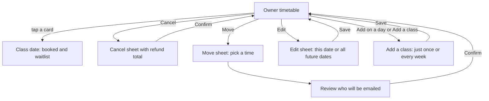

# Owner Class Management - Plan

## Goal Capsule

- **Objective:** A gym owner can add, change, move, and cancel classes from their phone, with the common actions one tap from the class they affect.
- **Means:** An owner timetable with Move, Edit, and Cancel on each card, opened as sheets from the page itself (KTD1).
- **Product authority:** This plan covers the owner's class management screens only. The member booking path, payments, refund rules, and the operator area are not active scope. The Product Contract below governs product behavior and the Planning Contract governs how it is built.
- **Execution profile:** One pull request, built and shipped by `lfg`. No part needs its own PR under the delivery rules. The new database migration must reach the hosted database before the new owner screens are used there (see Risks).
- **Open blockers:** None.

---

## Product Contract

### Summary

The owner's home becomes a timetable that looks like the one members see. Each class date carries Move, Edit, and Cancel on its card, each day has an Add, and an "Add a class" button stays on screen. Adding a one-off class and stopping a repeating class are new.

### Problem Frame

The owner opens a class date from a list, then scrolls past the booked list and three edit forms to reach Cancel at the bottom. Adding a class means filling a ten-field form that sits below the list of classes. Every class repeats weekly, so a holiday session or guest class cannot be added, and a weekly class that the gym stops running cannot be removed. The owner screens also keep the original plain styling and do not match the member screens.

The target is an owner who runs the whole timetable from a phone without having to learn where things are.

<!-- ce-section: work-relationships -->
### How This Work Fits Together

This plan covers the owner's class management screens. The breakdown below is the current understanding, not a committed roadmap. It builds on the first release in `docs/plans/2026-11-21-2249-feat-boxing-gym-class-booking-plan.md`, whose class, cancellation, and refund rules stay in force.

- Member booking path. Can proceed independently of this plan. Shares the class timetable layout, which this plan reuses for the owner.
- Trust and go-live (real payments, working emails, per-gym look). Can proceed independently of this plan. Still to decide when the pilot gym's payment documents are ready.
- Reminders and notifications. Still to decide. The first release deferred them.

### Actors

- A1. Gym owner: adds, changes, moves, and cancels classes, and sees who is booked.
- A2. Member: is refunded and emailed when the owner cancels or moves a date, under the rules already in force.

### Key Decisions

- **The owner's home mirrors the member timetable, with actions on each card.** (session-settled: user-directed - chosen over tidying the existing two-page flow and over a today-first board with a guided add: the user picked this layout from rough sketches.) Governs R1, R2, R5.
- **Adding a one-off class and stopping a repeating class are included.** (session-settled: user-approved - chosen over leaving classes weekly-only: "super easy" fails if the owner cannot add a holiday session or remove a class the gym stopped running.) Governs R5, R7.
- **A cancelled date stays cancelled, with no Restore.** (session-settled: user-approved - chosen over a Restore button: members are already refunded and removed from the waitlist.) Governs R9.
- **Existing refund and notification rules are unchanged.** Governs R8.

### Requirements

**The owner's timetable**

- R1. The owner's home shows the next 14 days grouped by day, in the same layout members see, with each class's time, name, spots taken, and status.
- R2. Each class date offers Move, Edit, and Cancel on its card, without opening another page first.
- R3. Tapping a class date shows who is booked, who is paying now, and who is on the waitlist.
- R4. A cancelled date stays visible in the timetable and is marked as cancelled.

**Adding and ending classes**

- R5. The owner adds a class from a day in the timetable or from an always-visible "Add a class" button, and chooses whether it happens once or repeats weekly.
- R6. A new class needs only a name, a time, a length, spots, and a price. Coach, level, description, and the cancellation window are optional and start with sensible defaults.
- R7. The owner can stop a repeating class. Stopping creates no new dates and removes future dates that nobody has booked. Dates that have bookings stay until the owner cancels them.

**Changing and cancelling**

- R8. Moving, editing, and cancelling a date keep the confirmations and rules of the first release: cancelling shows how many members will be refunded and the total before it takes effect, and moving a date with bookings shows who will be emailed.
- R9. A cancelled date cannot be restored.
- R10. On a repeating class, Edit asks whether the change is for this date only or for all future dates. A price change applies only to bookings made afterwards.

**Using it on a phone**

- R11. The owner screens use the SeshUp design system, work at phone width, and have tap targets of at least 44px.
- R12. After any action that changes members' bookings or money, the owner sees a plain-words result, such as how many members were refunded and emailed.

### Key Flows

- F1. Cancel a class at short notice
  - **Trigger:** A coach is sick or the gym must close for a class.
  - **Actors:** A1, A2
  - **Steps:** The owner taps Cancel on the class card, sees how many members will be refunded and the total, confirms, and sees the result.
  - **Covered by:** R2, R8, R12
- F2. Add a one-off class
  - **Trigger:** The owner wants a holiday session or a guest coach on one date.
  - **Actors:** A1
  - **Steps:** The owner taps Add on that day, chooses "Just once", fills the required details, and saves. The class appears on that day only.
  - **Covered by:** R5, R6
- F3. Stop a weekly class
  - **Trigger:** The gym no longer runs a class.
  - **Actors:** A1, A2
  - **Steps:** The owner chooses to stop the class and sees which future dates will be removed and which have bookings. Dates without bookings go. Dates with bookings stay until cancelled.
  - **Covered by:** R7, R8

### Acceptance Examples

- AE1. **Covers R2, R8.** Given a class with 10 booked members, when the owner taps Cancel on its card, then they see how many members will be refunded and the total, and nothing changes until they confirm.
- AE2. **Covers R5.** Given the owner taps Add on one day and chooses "Just once", when they save, then one class appears on that day and no later dates are created.
- AE3. **Covers R7.** Given a weekly class with a booked date next Tuesday and empty dates after it, when the owner stops the class, then the empty dates are removed, no new dates appear, and next Tuesday stays until the owner cancels it.
- AE4. **Covers R10.** Given a weekly class, when the owner changes the price for "all future dates", then dates booked before the change keep the price they were booked at.
- AE5. **Covers R4, R9.** Given a cancelled date, when the owner views the timetable, then it is marked cancelled and offers no way to restore it.

### Success Criteria

- The owner cancels a class in two taps from the home screen, the second being the confirmation.
- The pilot gym's owner adds a one-off class and cancels a class on their own phone without help.

### Scope Boundaries

**Deferred for later**

- Cancelling every class on a day at once, such as a public holiday.
- Copying last week's timetable or saving class templates.
- Restoring a cancelled date.
- Reminder and notification emails.
- A desktop-specific layout. The screens work on a wide screen but are designed for a phone.

**Outside this product's identity**

- General gym management such as payroll, marketing, or retail. SeshUp stays simple booking for boxing gyms.

### Dependencies / Assumptions

- The owner mainly uses a phone. This is assumed and not yet confirmed with the pilot gym's owner.
- The first release's rules stay in force: class fields and levels (R5 to R10), refunds on cancel (R16, R17), the price rule (R26), and the move-time notice (R27).
- Today the owner screens cannot add a one-off class and cannot end a repeating class. The owner actions in `app/admin/[gymSlug]/actions.ts` cover coaches, creating and updating a repeating class, editing a date, changing spots, moving a time, and cancelling a date. The `ended` flag on repeating classes exists in `supabase/migrations/20261121000005_schedule.sql` and nothing in the app sets it.
- R7's treatment of unbooked and booked future dates is the author's choice and was not discussed in detail.
- Every gym uses the same yellow accent for now. A per-gym accent is not part of this plan.

### Outstanding Questions

**Deferred to Planning**

- How "this date only" and "all future dates" in R10 interact with dates the owner already edited by hand. Planning checks the current repeating-class edit behavior in `app/admin/[gymSlug]/classes/[seriesId]/page.tsx`.
- Whether the owner timetable shows more than 14 days.

### Sources / Research

- Current owner screens: `app/admin/[gymSlug]/page.tsx`, `app/admin/[gymSlug]/series-form.tsx`, `app/admin/[gymSlug]/classes/page.tsx`, `app/admin/[gymSlug]/sessions/[sessionId]/page.tsx`.
- Member timetable and design tokens to reuse: `app/g/[gymSlug]/page.tsx`, `app/globals.css`.
- Design system canvas: https://claude.ai/artifact/X2VHMWnyYSDrJY7xiSuE9A
- Existing database functions this work builds on: `update_series`, `change_session_time`, `session_spots_taken`, and `generate_my_series_sessions` in `supabase/migrations/20261121000005_schedule.sql`, and `cancel_preview` and `owner_cancel_session` in `supabase/migrations/20261121000009_cancel_refund.sql`.

---

## Planning Contract

Product Contract unchanged.

### Key Technical Decisions

- KTD1. **The owner home is a server-rendered timetable, and Move, Edit, and Cancel open as sheets chosen by query parameters.** The member bookings page already opens its cancel sheet this way, so no client-side state is added. (session-settled: user-directed - chosen over tidying the two-page flow and over a today-first board: the user picked this layout from sketches.) Governed by R1, R2, R8, R12.
- KTD2. **A one-off class is a class date with no repeating class behind it, created by a new owner-facing database function.** Owners cannot insert dates directly because row-level security grants them updates to a few columns only, so the function checks that the caller is staff of the gym. (session-settled: user-approved - chosen over leaving classes weekly-only: an owner could not otherwise add a holiday session.) Governed by R5, R6. Rejected alternative: a repeating class with one day that is ended at once, which would clutter the class list and run the date generator for nothing.
- KTD3. **Stopping a repeating class is a new owner-facing database function that ends the class and deletes only the future dates nobody has booked.** It locks each date and rechecks before deleting, as `update_series` already does, so a booking in flight wins. (session-settled: user-approved - chosen over leaving classes weekly-only: an owner could not otherwise remove a class the gym stopped running.) Governed by R7.
- KTD4. **"This date only" and "All future dates" reuse the existing edit paths.** This date only uses the date edit action. All future dates opens the existing repeating-class edit form, whose `update_series` already skips dates that have bookings or their own edits. Prices already on bookings do not change because each booking stores the price it was made at. Governed by R10.
- KTD5. **Owner actions return to the page they came from.** Each existing action accepts a return path that must stay inside the same gym's admin area and falls back to the class date page, so a cancel from the timetable lands back on the timetable with its result message. Governed by R12.
- KTD6. **Admin pages move to the shared design classes in `app/globals.css` and the shared components in `app/ui.tsx`.** An admin layout supplies the header, the owner tabs, and the page frame, and the old inline style objects in `app/admin/styles.ts` are removed. Governed by R11.

### High-Level Technical Design

The owner timetable is the hub. Every action returns to it with a plain-words result.

### Assumptions

- The owner mainly uses a phone, so the sheets and forms are designed for phone width first.
- An Edit on a cancelled date is not offered. A cancelled card shows only its status and a way to open its details (R4, R9).
- The "All future dates" choice on Edit sends the owner to the existing repeating-class form rather than a new one. Its wording already explains that dates with bookings or their own changes keep their settings.
- A one-off class must start in the future. The same rule applies to moving a date.
- Class dates created from a one-off appear in the member timetable with no change, because the member timetable reads dates and not repeating classes.

### System-Wide Impact

- **Members:** One-off dates show in the member timetable like any other date. Cancel, move, and refund behavior is unchanged because the same owner functions run.
- **Date generation:** The per-minute job that fills in repeating dates ignores one-offs and ended classes.
- **Emails and refunds:** Unchanged. Nothing in this plan edits the outbox, refunds, or payments.

### Risks & Dependencies

- **The hosted database needs the new migration before the new screens are used there.** Until then, adding a one-off class and stopping a class fail with a database error while every other screen works. Apply the migration first, and the plain error message in U5 and U6 says what went wrong.
- **Spots taken is read once per date on the owner home.** This is how the screen works today and 14 days is a small number of dates, so it stays. Revisit if the timetable grows past 14 days.
- **A mistaken cancel is the costly mistake.** The confirm step with the refund total stays in front of every cancel (R8).

### Sequencing

U1 first because U5 and U6 call its functions. U2 before U3 because the layout frames every admin page. U4 builds on U3. U5 and U6 can follow in either order once U1 and U2 exist.

---

## Implementation Units

### U1. Owner database functions for one-off classes and stopping a class

- **Goal:** Give owners a safe way to add a single date and to end a repeating class.
- **Requirements:** R5, R6, R7. Covers AE2, AE3.
- **Dependencies:** None.
- **Files:** `supabase/migrations/20261124000013_owner_class_management.sql` (create), `tests/db/owner-classes.test.ts` (create).
- **Approach:**
  - Add `create_one_off_class`, owner-facing and security definer with a pinned search path, following the pattern of `update_series`. It checks the caller is staff of the gym, requires a future start, and inserts a date with no repeating class. The date's local day comes from the gym's time zone. It returns the new date's id.
  - Add `end_series`, owner-facing in the same way. It locks the repeating class, marks it ended, then walks its future dates in a fixed order, locking each and deleting it only when it is not cancelled and has no booking rows and no waitlist entries, so cancelled dates stay visible (R4). It returns how many dates were removed and how many remain.
  - Grant execute to signed-in users only, as the other owner functions do.
- **Execution note:** Write the database tests first, since the repo proves owner functions through `tests/db`.
- **Patterns to follow:** `update_series` and `generate_my_series_sessions` in `supabase/migrations/20261121000005_schedule.sql`, and the grants block in `supabase/migrations/20261121000003_rls_policies.sql`. The database test seam catches permission and data rules and does not catch page behavior.
- **Test scenarios:**
  - Covers AE2. Staff of the gym creates a one-off for tomorrow 18:00, and exactly one date exists with no repeating class and the right local day and start time.
  - A creator who is not staff of that gym is refused with `not_staff`, and a member with no staff role is refused too.
  - A start time in the past is refused with `time_in_past`.
  - A coach from another gym is refused.
  - Covers AE3. A weekly class has a booked next Tuesday and empty dates after it. After `end_series`, the empty dates are gone, next Tuesday remains, and the result reports the counts.
  - After `end_series`, running the date generator creates no new dates for that class.
  - A date with only a waitlist entry is kept.
  - A cancelled future date with no bookings is kept, so it stays visible as cancelled.
  - Calling `end_series` twice returns zero removed the second time and does not error.
  - Staff of another gym cannot end the class.
- **Verification:** The new database tests pass along with the existing suite.

### U2. Owner shell and shared look for the admin pages

- **Goal:** Make every admin page use the design system and share one frame.
- **Requirements:** R11.
- **Dependencies:** None.
- **Files:** `app/admin/[gymSlug]/layout.tsx` (create), `app/admin/[gymSlug]/classes/page.tsx`, `app/admin/[gymSlug]/classes/[seriesId]/page.tsx`, `app/admin/[gymSlug]/coaches/page.tsx`, `app/admin/[gymSlug]/series-form.tsx`, `app/admin/[gymSlug]/sessions/[sessionId]/page.tsx`, `app/admin/banner.tsx`, and `app/admin/styles.ts` (remove).
- **Approach:**
  - The layout renders the gym's header from `app/ui.tsx`, a row of owner tabs (Timetable, Classes, Coaches, Member view), and the page content directly under the page frame so a page's sticky action bar still sits at the bottom.
  - Pages replace inline style objects with the shared classes and use the shared alert for messages. Forms use the shared field and input classes.
  - The class date page keeps its content (R3) and gains the new look. The sheet-based actions come in U4.
  - Remove `app/admin/styles.ts` once nothing imports it.
- **Patterns to follow:** `app/g/[gymSlug]/page.tsx` and `app/account/bookings/page.tsx` for the frame, cards, and alerts, and `app/ui.tsx` for the shared pieces.
- **Test scenarios:** Test expectation: none -- presentation only, proven by typecheck, lint, the production build, and a look at the pages on a phone-sized screen.
- **Verification:** Every admin page renders in the new look at phone width and no file imports the removed style module.

### U3. Owner timetable home

- **Goal:** Replace the owner home with a day-grouped timetable of the next 14 days that shows each date's status and its actions.
- **Requirements:** R1, R2, R3, R4, R9. Covers AE5.
- **Dependencies:** U2.
- **Files:** `app/admin/[gymSlug]/page.tsx` (rewrite), `lib/admin/timetable.ts` (create), `tests/unit/admin/timetable.test.ts` (create).
- **Approach:**
  - Read the next 14 days of dates including cancelled ones, with each date's repeating-class id and the spots taken from `session_spots_taken`.
  - A pure helper in `lib/admin/timetable.ts` groups dates by the gym's local day and labels today, so the day logic is unit tested apart from the page.
  - Each card is a container, not a link. Its main area (time, name, spots taken of the limit, and a status badge) links to the class date page. A separate row beneath holds Move, Edit, and Cancel as three equal-width small buttons that are at least 44px tall, with Cancel styled as the destructive one. The three set the sheet parameters read in U4. Nothing is nested inside the main link.
  - A cancelled card keeps its main link, uses the cancelled card style already in `app/globals.css`, and has no action row, so the owner can still open it to check who was refunded.
  - Each day heading carries a "+ Add" link to the add page for that date, and a sticky "Add a class" button sits at the bottom.
  - When no dates fall in the next 14 days, the page shows a "No classes yet" alert that points to the "Add a class" button, since no day heading exists to carry a "+ Add".
- **Patterns to follow:** the day grouping and card markup in `app/g/[gymSlug]/page.tsx`.
- **Test scenarios:**
  - Dates are grouped by the gym's local day, so a class at 22:30 UTC lands on the next day for a Johannesburg gym.
  - Groups come out in time order and a day with no classes is not listed.
  - The day matching today in the gym's zone is labeled today.
  - An empty list returns no groups.
  - A cancelled date is flagged so the page can hide its actions.
- **Verification:** The unit tests pass and the owner home shows the grouped timetable with actions on live cards only.

### U4. Cancel, Move, and Edit sheets on the timetable

- **Goal:** Let the owner cancel, move, and edit a date from the timetable and land back on it with a plain result.
- **Requirements:** R2, R8, R10, R12. Covers AE1, AE4.
- **Dependencies:** U3.
- **Files:** `app/admin/[gymSlug]/page.tsx`, `app/admin/[gymSlug]/sheets.tsx` (create), `app/globals.css`, `app/admin/[gymSlug]/actions.ts`, `app/admin/[gymSlug]/sessions/[sessionId]/cancel-action.ts`, `lib/admin/return-path.ts` (create), `tests/unit/admin/return-path.test.ts` (create).
- **Approach:**
  - The page reads the sheet and date from the query and renders one sheet over the timetable, as the member bookings page does. Each sheet is labeled with its action and the class name, carries a visible Close link and the scrim link back to the timetable, and the links that open or close a sheet do not scroll the page to the top.
  - The shared sheet class is extended so a sheet never grows past the visible screen: its height is capped to the screen and its content scrolls inside it. The Edit sheet is the tall one and would otherwise run off a phone screen.
  - The Cancel sheet calls `cancel_preview` and shows how many members will be refunded, the total, and how many waitlisted members are removed, then confirms through the existing cancel action.
  - The Move sheet keeps the two-step flow that exists on the date page: pick a time, then review how many members will be emailed.
  - The Edit sheet changes price, coach, cancellation hours, and spots for this date. The spot limit is saved first so a refusal for going below the spots taken stops the whole save. On a repeating class it also offers "All future dates", which opens the class's edit form (KTD4).
  - A helper in `lib/admin/return-path.ts` wraps the existing `safeNextPath` in `lib/auth/redirect.ts` and adds one check: the path must stay inside the same gym's admin area. The existing actions use it with the class date page as the fallback (KTD5). Result messages keep the wording the existing actions already produce and show at the top of the timetable.
- **Patterns to follow:** the cancel sheet in `app/account/bookings/page.tsx` and the existing two-step blocks in `app/admin/[gymSlug]/sessions/[sessionId]/page.tsx`.
- **Test scenarios:**
  - A path inside the gym's admin area is accepted and used as the return path.
  - A path for another gym falls back to the class date page.
  - An absolute URL, a protocol-relative URL, and an empty value all fall back.
  - A path with encoded characters that would climb out of the gym's area falls back.
  - Covers AE1. The cancel sheet's refund count and total come from the existing `cancel_preview` function and the cancel itself from `owner_cancel_session`, both already proven in `tests/db/cancel.test.ts`. The sheet only shows and confirms them, so this unit adds no new test for AE1.
  - Covers AE4. Test expectation for the price rule: proven in the existing database tests, because bookings store their price when made. The sheet only chooses the scope.
- **Verification:** The unit tests pass, and from the timetable a cancel, a move, and an edit each return to it with a result message.

### U5. Add a class: just once or every week

- **Goal:** Replace the long form with a short add flow that creates a one-off or a repeating class.
- **Requirements:** R5, R6. Covers AE2.
- **Dependencies:** U1, U2.
- **Files:** `app/admin/[gymSlug]/classes/new/page.tsx` (create), `app/admin/[gymSlug]/series-form.tsx`, `app/admin/[gymSlug]/actions.ts`, `app/admin/[gymSlug]/classes/page.tsx`, `lib/booking/schedule.ts`, `tests/unit/booking/schedule.test.ts`.
- **Approach:**
  - The add page opens on "Just once" when it arrives with a date from a day's "+ Add", and on "Every week" otherwise. The choice is the first control on the page, a plain link toggle so the page needs no client script, and it sits before any field so switching loses nothing the owner typed. The one-off date starts empty from the "Add a class" button, is filled in from a day's "+ Add", and cannot be earlier than today.
  - Required fields show first: name, the date or the weekdays, start time, length, spots, and price. Coach, level, description, and cancellation hours sit under a collapsed "More options" with the existing defaults.
  - A one-off converts the date and time to an instant in the gym's time zone and calls the U1 function. A weekly class keeps the existing create path.
  - The Classes page lists repeating classes with a link to add one, and the long inline form is removed.
  - Database errors from the new function are mapped to plain messages in `friendlyError`.
- **Patterns to follow:** `parseSeriesForm` and `createSeries` in `lib/booking/schedule.ts`, and `zonedTimeToUtc` in `lib/time/gym-time.ts`.
- **Test scenarios:**
  - Covers AE2. A valid one-off form parses to a start instant in the gym's zone and the chosen length, spots, and price.
  - A one-off with no date or a malformed date is rejected with a plain message.
  - A one-off with a price of zero or a spot limit below one is rejected.
  - Optional fields left blank take the defaults, including a 12 hour cancellation window.
  - A weekly form with no days chosen is still rejected as before.
  - The database message `time_in_past` becomes a plain "Choose a time in the future." message.
- **Verification:** The unit tests pass, and a one-off added from a day appears on that day only.

### U6. Stop a repeating class

- **Goal:** Let the owner end a repeating class and see what that removes before confirming.
- **Requirements:** R7, R8, R12. Covers AE3.
- **Dependencies:** U1, U2.
- **Files:** `app/admin/[gymSlug]/classes/[seriesId]/page.tsx`, `app/admin/[gymSlug]/actions.ts`, `lib/booking/schedule.ts`, `tests/unit/booking/schedule.test.ts`.
- **Approach:**
  - The repeating class page gains a "Stop this class" link that opens a confirm sheet in the style of the cancel sheet. It shows how many empty future dates will be removed and lists the future dates that have bookings and will stay, each with its booked count (F3). Cancelled dates are not listed because they stay as cancelled (R4).
  - Confirming calls the U1 `end_series` function through a new action and returns to the timetable with a message built by a small pure helper, so the wording and plurals are unit tested.
  - A class that has already stopped shows a note and no edit form. The Classes page already lists only classes that have not ended.
- **Patterns to follow:** the two-step cancel on `app/admin/[gymSlug]/sessions/[sessionId]/page.tsx`.
- **Test scenarios:**
  - Covers AE3. The result message names how many dates were removed and how many stay, with correct singular and plural wording.
  - Zero removed and zero kept still produces a sensible message.
  - A class that has already ended is shown as stopped and offers no edit form.
- **Verification:** The unit tests pass, and stopping a class removes its empty future dates while dates with bookings remain.

---

## Verification Contract

| Check | Command | Applies to |
|---|---|---|
| Types | `npm run typecheck` | All units |
| Lint | `npm run lint` | All units |
| Unit tests | `npm test` | U3, U4, U5, U6 |
| Database tests | `npm run test:db` | U1, and the existing suite for regressions |
| Production build | `npm run build` | All units |

The Paystack test-mode check and the end-to-end auth test are unrelated to this change and stay as they are.

---

## Definition of Done

- Every requirement R1 to R12 is met by a unit above, and each unit's verification holds.
- The five checks in the Verification Contract pass.
- Admin pages no longer import `app/admin/styles.ts`, and the file is removed.
- No abandoned experiment code remains in the diff.
- The pull request notes that the new migration must be applied to the hosted database before the new owner screens are used there.
